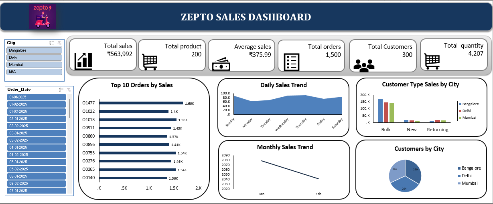

# Zepto Sales Analysis & Dashboard

## 📌 Project Description
This project focuses on cleaning, analyzing, and visualizing Zepto sales data using Microsoft Excel. The objective is to identify sales trends, evaluate product and category performance, analyze customer segments and payment methods, and generate meaningful business insights through an interactive dashboard.

## 🛠️ Tools Used
- Microsoft Excel
- Pivot Tables
- Pivot Charts
- Excel Formulas
- Data Cleaning
- Data Analysis
- Data Visualization

## 📊 Key Areas of Analysis
- **Sales Performance:** Analyze total sales and sales trends over time.
- **Product & Category Analysis:** Identify top-performing products and categories.
- **Customer Segmentation:** Examine customer-related sales patterns.
- **Payment Method Analysis:** Compare sales across different payment methods.
- **Delivery Performance:** Analyze delivery statuses and delivery-related data.
- **KPI Analysis:** Track important business metrics through dashboard cards.

## 📈 Key Performance Indicators
- **Total Sales:** ₹563,992.25
- **Total Orders:** 1,500
- **Total Products:** 200
- **Total Customers:** 300
- **Total Quantity Sold:** 4,207
- **Average Sales per Order:** ₹375.99

## 💡 Key Insights
- Beverages recorded the highest category sales at ₹82,603.27.
- UPI was the leading payment method by sales, contributing ₹188,838.25.
- The dashboard highlights sales performance, top products, and category-level trends.

## 📷 Dashboard Preview

## 📁 Project Files
- `Zepto_Sales_Dashboard.xlsx` — Excel dashboard and analysis.
- `zepto-sales-dashboard.png` — Dashboard preview image.
- `zepto_sales_raw.xlsx` — Raw sales dataset.
- `data-cleaning-documentation.pdf` — Data cleaning documentation.

## 🎯 Outcome
This project demonstrates practical skills in Excel-based data cleaning, KPI calculation, Pivot Tables, chart creation, dashboard development, and business data analysis.

It provides a structured view of sales performance and helps communicate key business findings through visual reporting.

## 👩‍💻 Skills Demonstrated
Microsoft Excel | Data Cleaning | Data Analysis | Pivot Tables | Data Visualization | Dashboard Development | Business Intelligence
